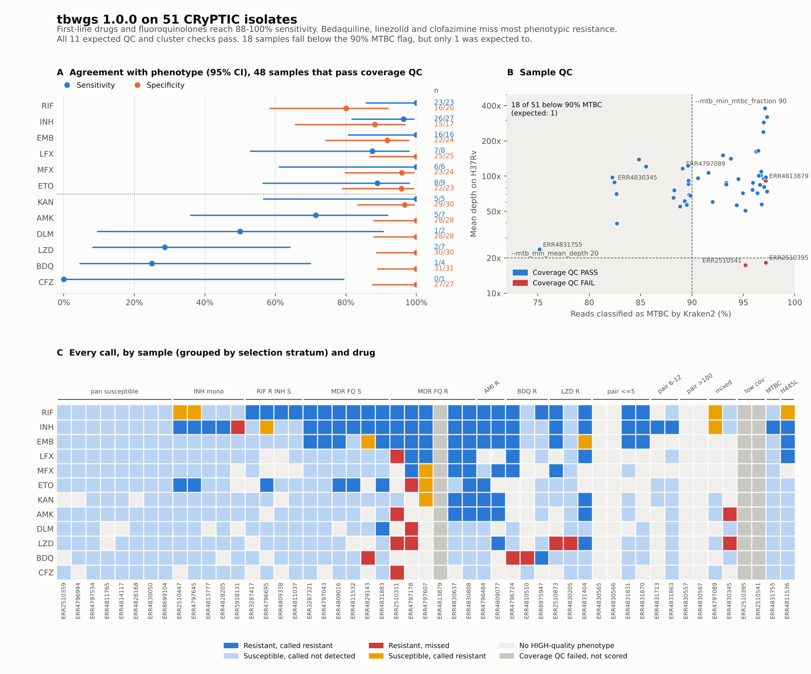

# Validation on 51 CRyPTIC isolates

tbwgs 1.0.0 was run on 51 public CRyPTIC isolates on Seqera Platform with AWS Batch. All 11 expected QC and cluster checks pass. For the first-line drugs and the fluoroquinolones, sensitivity against phenotype is 88–100%. For bedaquiline, linezolid and clofazimine it is 0–29%, which matches the known limits of the WHO mutation catalogue for these drugs.



## Data

- **Isolates:** 51 CRyPTIC isolates from ENA, selected by stratum. The strata cover pan-susceptible, INH mono-resistant, RR, MDR with and without FQ resistance, AMK, BDQ and LZD resistance. There are also 4 same-patient pairs with known SNP distances, 2 suspected mixed infections, 2 low-coverage isolates and 2 isolates from the [tbtamr comparison](tbtamr_comparison.md). The selection code and the full sample set are in `docs/validation/formal_validation_set/` on the `dev` branch.
- **Truth:** CRyPTIC binary phenotypes, filled only where the MIC quality is HIGH (`inputs/truth_phenotypes.tsv`). The expected QC and cluster results are in `inputs/expected_qc_and_clusters.tsv`.
- **tbwgs:** release 1.0.0 (`7620e92`), TB-Profiler 6.7.0, tbdb who_v2+ @ `c4167762`, Kraken2 `k2_standard_08gb_20240904`. It was run with `-profile docker` on AWS Batch (SPOT, us-east-1) with Fusion. `KRAKEN2_KRAKEN2` was given 8 CPUs and 16 GB. All other settings were the defaults.
- **Reads:** fetched from the ENA FTP server over https. For every sample, the number of bases that fastp read matches the ENA `base_count` (`inputs/read_completeness.tsv`).

## Run

| Run                          | Status    | Wall time | Cost (AWS) | Note                                                           |
| ---------------------------- | --------- | --------- | ---------- | -------------------------------------------------------------- |
| `tbwgs_v1_0_0_validation_51` | failed    |           | $0.36      | The staged copy of `ERR3287321_2.fastq.gz` had a CRC error.    |
| `tbwgs_v1_0_0_validation_52` | succeeded | 68 min    | $0.87      | Resumed after the bad staged file was deleted.                 |
| `tbwgs_v1_0_0_validation_53` | succeeded | 25 min    | $0.03      | Resumed with an MD5-checked copy of ERR3287321 (see Findings). |

The total cost was about $1.26. Most of the wall time was spent on downloads from ENA. There were no SPOT interruptions and no failed tasks in the last two runs.

## Results

### Drug resistance against phenotype

The 48 isolates that pass coverage QC are scored. `resistant` counts as R and `not_detected` as S. No call was `uninterpretable`. The intervals are 95% Wilson intervals.

| Drug         | TP  | FN  | FP  | TN  | Sensitivity (95% CI) | Specificity (95% CI) |
| ------------ | --- | --- | --- | --- | -------------------- | -------------------- |
| Rifampicin   | 23  | 0   | 4   | 16  | 100% (86–100)        | 80% (58–92)          |
| Isoniazid    | 26  | 1   | 2   | 15  | 96% (82–99)          | 88% (66–97)          |
| Ethambutol   | 16  | 0   | 2   | 22  | 100% (81–100)        | 92% (74–98)          |
| Levofloxacin | 7   | 1   | 0   | 25  | 88% (53–98)          | 100% (87–100)        |
| Moxifloxacin | 6   | 0   | 1   | 23  | 100% (61–100)        | 96% (80–99)          |
| Ethionamide  | 8   | 1   | 1   | 22  | 89% (57–98)          | 96% (79–99)          |
| Kanamycin    | 5   | 0   | 1   | 29  | 100% (57–100)        | 97% (83–99)          |
| Amikacin     | 5   | 2   | 0   | 28  | 71% (36–92)          | 100% (88–100)        |
| Delamanid    | 1   | 1   | 0   | 28  | 50% (9–91)           | 100% (88–100)        |
| Linezolid    | 2   | 5   | 0   | 30  | 29% (8–64)           | 100% (89–100)        |
| Bedaquiline  | 1   | 3   | 0   | 31  | 25% (5–70)           | 100% (89–100)        |
| Clofazimine  | 0   | 1   | 0   | 27  | 0% (0–79)            | 100% (88–100)        |

Most drugs have fewer than 10 resistant isolates, so the intervals are wide.

### Calls that disagree with phenotype

No false negative carries a catalogue resistance mutation. Most false positives are borderline mutations, a mixed sample or a likely phenotype error.

| Drug          | Sample                                                     | Phenotype (MIC) | tbwgs                        | Likely cause                                                                          |
| ------------- | ---------------------------------------------------------- | --------------- | ---------------------------- | ------------------------------------------------------------------------------------- |
| RIF           | ERR4811536                                                 | S (0.5)         | R, `rpoB` p.His445Leu        | Known borderline mutation. This difference was expected.                              |
| RIF           | ERR2510447                                                 | S (0.5)         | R, `rpoB` p.Leu430Pro        | Borderline mutation, MIC close to the breakpoint.                                     |
| RIF           | ERR4797645                                                 | S (≤0.06)       | R, `rpoB` p.Thr427Asn        | "Assoc w R - Interim" mutation, which tbwgs reports as resistant.                     |
| RIF, INH      | ERR4797089                                                 | S               | R, at 24–34% allele fraction | Mixed infection. The mutations come from the minor strain.                            |
| INH           | ERR4796695                                                 | S (0.1)         | R, `inhA` c.-777C>T          | Low-level resistance mutation, MIC close to the breakpoint.                           |
| EMB           | ERR4829143, ERR4831404                                     | S (2.0)         | R, `embB` M306I / G406A      | MIC close to the breakpoint.                                                          |
| MFX, KAN, ETO | ERR4797607                                                 | S               | R                            | `gyrA` D94N, `rrs` n.1401A>G and `inhA` c.-777C>T are strong. Likely phenotype error. |
| INH           | ERR5918131                                                 | R (3.2)         | S                            | No catalogue mutation.                                                                |
| LFX           | ERR2510311                                                 | R (>8)          | S                            | No `gyrA` or `gyrB` mutation.                                                         |
| BDQ           | ERR4796724, ERR4810510, ERR4829143                         | R               | S                            | No catalogue mutation in `mmpR5`, `atpE` or `pepQ`.                                   |
| LZD           | ERR2510311, ERR2510873, ERR4797178, ERR4830205, ERR4830345 | R               | S                            | No catalogue mutation in `rplC` or `rrl`.                                             |
| AMK           | ERR2510311, ERR4830345                                     | R               | S                            | No catalogue mutation in `rrs` or `eis`.                                              |
| CFZ, DLM, ETO | ERR2510311, ERR4797178                                     | R               | S                            | No catalogue mutation.                                                                |

If interim mutations were not counted as resistant, rifampicin specificity would be 85% (17/20).

### QC, lineage and clustering

| Check              | Samples                 | Expected                | Observed               | Pass |
| ------------------ | ----------------------- | ----------------------- | ---------------------- | ---- |
| Low coverage       | ERR2510395, ERR2510541  | `coverage_qc` FAIL      | FAIL (18.4×, 17.4×)    | yes  |
| Suspected mixed    | ERR4797089, ERR4830345  | `mixed_lineage` yes     | yes (L1 + L4, L1 + L2) | yes  |
| Low MTBC fraction  | ERR4831755              | `mtbc_flag` LOW_MTBC    | LOW_MTBC (75.2%)       | yes  |
| `rpoB` p.His445Leu | ERR4811536              | rifampicin resistant    | resistant              | yes  |
| Pair ≤5 SNPs       | ERR4830565 / ERR4830566 | same 5-SNP cluster      | T5-1 / T5-1            | yes  |
| Pair ≤5 SNPs       | ERR4831831 / ERR4831870 | same 5-SNP cluster      | T5-2 / T5-2            | yes  |
| Pair, 11 SNPs      | ERR4831713 / ERR4831863 | same 12-SNP cluster     | T12-2 / T12-2          | yes  |
| Pair, 1,121 SNPs   | ERR4830557 / ERR4830567 | not clustered           | not clustered          | yes  |
| Lineage            | 49 isolates             | same lineage as CRyPTIC | 49/49                  | yes  |

## Findings

1. **18 of 51 isolates get the LOW_MTBC flag, but only 1 was expected to.** The other 17 have 82–90% MTBC reads, just below `--mtb_min_mtbc_fraction 90` (panel B). Their calls are not affected, because the flag does not stop any step. The likely cause is that the 8 GB Kraken2 database leaves part of the MTB reads unclassified, but this has not been checked in the Kraken2 reports yet. A threshold of 80% would flag only ERR4831755.
2. **Reads fetched over https can be corrupted without an error.** ERR3287321 failed twice. In the first run the staged R2 file had a CRC error, so FASTQC failed. In the second run the staged file was cut short, so fastp read only 8.8% of the bases. The pipeline did not stop; the sample only failed coverage QC. The run was finished with a copy of the reads whose MD5 matched ENA. For runs that matter, stage the reads first with an MD5 check, or check read counts after staging.
3. **ERR4813879 fails coverage QC although its data are complete.** Its mean depth is 91×, but the breadth is 92% and the consensus has 12.3% N. This was not expected and needs a look at its coverage profile.
4. **Interim mutations count as resistant.** This gives one rifampicin false positive (ERR4797645, `rpoB` p.Thr427Asn). Decide whether reports should show interim calls apart from resistant calls.

## How to build the tables and the figure again

Run these commands from the repository root:

```bash
D=docs/validation/formal_validation_51
python $D/code/compare_formal_validation.py # writes $D/tables/*.tsv
python $D/code/plot_formal_validation.py    # needs matplotlib
```

| File                                  | Content                                                               |
| ------------------------------------- | --------------------------------------------------------------------- |
| `inputs/mtb_summary.tsv`              | tbwgs summary from the final run                                      |
| `inputs/truth_phenotypes.tsv`         | CRyPTIC phenotypes and MICs                                           |
| `inputs/expected_qc_and_clusters.tsv` | Expected result for each edge case and pair                           |
| `inputs/read_completeness.tsv`        | ENA base count and fastp input bases for each sample                  |
| `tables/per_sample_drug_calls.tsv`    | One row per sample × drug, with the outcome                           |
| `tables/per_drug_performance.tsv`     | TP, FN, FP, TN, sensitivity and specificity with 95% Wilson intervals |
| `tables/expected_checks.tsv`          | Expected and observed result for each QC, lineage and cluster check   |

The full results (BAM, VCF, TB-Profiler, MultiQC) are in `s3://wei2026-us/tbwgs/results/validation_51/`.
