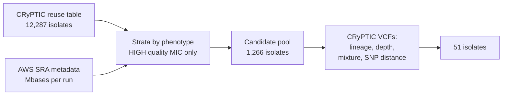

# tbwgs formal validation set (51 CRyPTIC isolates)

This page describes the sample set for the formal validation run of tbwgs release 1.0.0 on
Seqera Platform with AWS Batch. The files are in [`formal_validation_set/`](formal_validation_set/):
the samplesheets, the phenotype truth table, the expected QC and cluster results, and the code
that selected the samples. All paths below are relative to that folder.

> **Status:** sample set only. No run has been done with it yet.

## Files

| File                                   | Content                                                                                                                                                          |
| -------------------------------------- | ---------------------------------------------------------------------------------------------------------------------------------------------------------------- |
| `samplesheet_ena.csv`                  | tbwgs samplesheet. Reads come from the ENA FTP server over https.                                                                                                |
| `samplesheet_s3.csv`                   | tbwgs samplesheet for reads staged in your S3 bucket. Replace `s3://YOUR-BUCKET/tbwgs-validation/reads`.                                                         |
| `run_list.txt`                         | The 51 ENA run accessions. Input for `code/stage_reads_from_sra_odp.sh`.                                                                                         |
| `truth_phenotypes.tsv`                 | CRyPTIC binary phenotype, MIC and MIC quality for each drug. The phenotype column is filled only when the quality is HIGH. Column names match `mtb_summary.tsv`. |
| `expected_qc_and_clusters.tsv`         | Expected result for each edge case and each same-patient pair.                                                                                                   |
| `tables/selected_samples.tsv`          | The selected isolates with all metadata.                                                                                                                         |
| `tables/cryptic_pool_annotated.tsv`    | The candidate pool (1,266 isolates) with lineage, depth and mixture signal from the CRyPTIC VCFs.                                                                |
| `tables/same_patient_snp_distance.tsv` | SNP distance for each pair of isolates from the same patient (527 pairs).                                                                                        |
| `tables/ena_filereport.tsv`            | ENA file report: FASTQ paths, MD5, bytes and read counts.                                                                                                        |

All 51 runs are Illumina paired-end. Each run has exactly two FASTQ files on ENA and one `.sra` file in
the AWS SRA open-data bucket (`s3://sra-pub-run-odp/sra/<run>/<run>`). The total is 19.1 GB of gzipped
FASTQ (30.8 Gbases).

## Which samplesheet to use

The tbwgs schema accepts only `.fastq.gz` files. The AWS SRA open-data bucket has only `.sra` files.
Use one of these two options:

1. **ENA over https.** Use `samplesheet_ena.csv` as it is. Each Batch job downloads its reads from EBI.
2. **Stage to S3 first.** Run `code/stage_reads_from_sra_odp.sh run_list.txt s3://<bucket>/tbwgs-validation/reads`
   on an EC2 instance in us-east-1. Then use `samplesheet_s3.csv` with your bucket name.

Option 2 is faster and more reliable for repeated runs, because the reads stay in your region.

## Sample set



| Group                         | n       | Rule                                                               |
| ----------------------------- | ------- | ------------------------------------------------------------------ |
| Pan-susceptible               | 8       | S to all 13 drugs                                                  |
| INH mono-resistant            | 5       | INH R, RIF S, RFB not R, LEV S                                     |
| RIF R, INH S                  | 4       |                                                                    |
| MDR, FQ S                     | 6       | INH R, RIF R, LEV S, MXF S                                         |
| MDR, FQ R                     | 6       | INH R, RIF R, LEV or MXF R                                         |
| BDQ R                         | 3       |                                                                    |
| LZD R                         | 3       |                                                                    |
| AMI R                         | 2       | AMI R and KAN R                                                    |
| Same-patient pair, 0–1 SNP    | 2 pairs | Expected in the same 5-SNP cluster                                 |
| Same-patient pair, 11 SNPs    | 1 pair  | Expected in the same 12-SNP cluster                                |
| Same-patient pair, 1,121 SNPs | 1 pair  | Different lineages. Expected not clustered                         |
| Low coverage                  | 2       | About 10x and 14x in the CRyPTIC VCF                               |
| Suspected mixed               | 2       | Markers of two lineages at intermediate read fractions             |
| Overlap with the first 8      | 2       | ERR4811536 (`rpoB` p.His445Leu) and ERR4831755 (low MTBC fraction) |

Rules for the phenotype groups:

- One sequencing run, at least 40x depth in the CRyPTIC VCF, at most 150 low-FRS sites, and a lineage call.
- HIGH quality INH and RIF phenotypes, and an R or S EMB phenotype.
- Not one of the first 8 isolates (see [tbtamr_comparison.md](tbtamr_comparison.md)).
- Within a group, the picks rotate over lineage first and then over CRyPTIC site.

The set has these HIGH-quality phenotypes:

| Drug         | R   | S   |
| ------------ | --- | --- |
| Isoniazid    | 30  | 17  |
| Rifampicin   | 26  | 20  |
| Ethambutol   | 17  | 26  |
| Levofloxacin | 11  | 25  |
| Moxifloxacin | 7   | 24  |
| Amikacin     | 7   | 31  |
| Kanamycin    | 5   | 32  |
| Linezolid    | 7   | 33  |
| Bedaquiline  | 4   | 33  |
| Ethionamide  | 9   | 26  |
| Delamanid    | 2   | 30  |
| Clofazimine  | 1   | 30  |

Lineages: L1 10, L2 20, L3 10, L4 9, and 2 without a single lineage call (one mixed sample and ERR4811536,
which has no VCF in the pool). CRyPTIC has no L5, L6 or L7 isolates that pass these rules.

## Limits

- CRyPTIC isolates were used to build the WHO catalogue v2. Genomic calls are therefore not independent
  of the catalogue. Add local isolates for an independent check.
- CRyPTIC has no pyrazinamide or streptomycin phenotype. Those calls cannot be checked with this set.
- The counts of BDQ R, LZD R, DLM R and CFZ R isolates are small. They show detection, not sensitivity.
- Lineage, depth and mixture come from the CRyPTIC VCFs, not from tbwgs. tbwgs will compute its own values.
- The same-patient SNP distances come from the CRyPTIC per-sample VCFs. Filtered sites in either
  sample are left out.

## Reproduce

```bash
# Run from docs/validation/formal_validation_set/
# 1. Inputs
curl -O https://ftp.ebi.ac.uk/pub/databases/cryptic/release_june2022/reuse/CRyPTIC_reuse_table_20240917.csv
#    sha256 f785ae87f2bfb7f39f08d2ca2618a1925a290c39bfdfd5a535995b1827541c1b
python code/fetch_sra_metadata.py mtb_sra.parquet          # AWS SRA metadata, anonymous S3

# 2. Candidate pool and its VCFs
python code/build_pool.py CRyPTIC_reuse_table_20240917.csv mtb_sra.parquet ../tbtamr_comparison/inputs/sample_manifest.csv pool
mkdir vcf && (cd vcf && xargs -P 8 -n 1 curl -sS --retry 5 -O < ../pool.vcf_urls)
python code/summarise_cryptic_vcfs.py vcf <tbdb>/barcode.bed <tbdb>/genome.fasta vcfsum
python code/annotate_pool.py pool.table.tsv vcfsum.tsv tables/cryptic_pool_annotated.tsv
python code/snp_distance.py vcfsum.snps.json tables/cryptic_pool_annotated.tsv tables/same_patient_snp_distance.tsv

# 3. Selection and samplesheets (deterministic)
python code/select_samples.py tables/cryptic_pool_annotated.tsv tables/same_patient_snp_distance.tsv tables/selected_samples.tsv
python code/make_samplesheets.py tables/selected_samples.tsv tables/ena_filereport.tsv . s3://<bucket>/tbwgs-validation/reads
```

`<tbdb>` is the frozen tbdb who_v2+ @ `c4167762` archive from
[biowei/tbwgs-test-datasets](https://github.com/biowei/tbwgs-test-datasets).
The committed pool also has about 200 isolates from a first download pass. Step 3 gives the same
51 isolates from the committed files.
