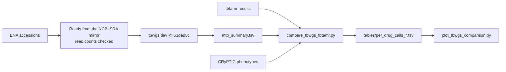

# Comparison with tbtamr on 8 CRyPTIC isolates

tbwgs agrees with [tbtAMR](https://github.com/MDU-PHL/tbtamr) on 119 of 120 sample × drug calls. Every resistant call agrees, and so does the mutation behind it. Against phenotype, both tools score 23 of 24. This page shows how the comparison was made and what it found.


## Data

- **Isolates:** 8 public CRyPTIC isolates from [biowei/tbtamr-validation](https://github.com/biowei/tbtamr-validation). They cover the profiles S/S/S, S/R/S, R/S/S, R/R/S, R/S/R and R/R/R for isoniazid, rifampicin and ethambutol.
- **Reference results:**
  - tbtamr 1.0.4 with the WHO catalogue v2, from the validation repository (`inputs/tbtamr_raw_results.csv`).
  - CRyPTIC binary phenotypes for INH, RIF and EMB (`inputs/sample_manifest.csv`).
- **tbwgs:** `dev` at `51ded8c` (TB-Profiler 6.7.0, tbdb who_v2+ @ `c4167762`). It was run with `-profile conda` and the Kraken2 `k2_standard_08gb_20240904` database.

## Results

| Comparison                                    | Agreement           |
| --------------------------------------------- | ------------------- |
| tbwgs vs tbtamr, 8 isolates × 15 drugs        | **119/120 (99.2%)** |
| tbwgs vs tbtamr, before the rule change in #9 | 117/120 (97.5%)     |
| tbwgs vs phenotype (INH, RIF, EMB)            | 23/24 (95.8%)       |
| tbtamr vs phenotype (INH, RIF, EMB)           | 23/24 (95.8%)       |

- **Resistant calls:** all 27 agree, and so do their mutations. Examples are `rpoB` S450L, `katG` S315T, `inhA` c.-154G>A, `embB` M306V, `rrs` n.1401A>G and `gyrA` D94G. tbtamr's "Moderate" grade matches tbwgs's "Assoc w R - Interim" grade, for example `pncA` K48T.
- **Disagreements:** no disagreement is resistant against susceptible. Each disagreement is a drug that tbwgs calls `uninterpretable` because a gene has a median depth below `--mtb_min_site_depth`, while tbtamr calls it susceptible.

| Sample     | Drug        | tbwgs, first run  | tbwgs now         | Cause                                                                                 |
| ---------- | ----------- | ----------------- | ----------------- | ------------------------------------------------------------------------------------- |
| ERR4813225 | linezolid   | `uninterpretable` | `uninterpretable` | `rrl` median depth 7×, against 36× for the whole genome. This is a real coverage gap. |
| ERR4813225 | capreomycin | `uninterpretable` | `not_detected`    | Low `rrl` coverage, but `rrl` carries no capreomycin resistance mutation.             |
| ERR8975345 | ethionamide | `uninterpretable` | `not_detected`    | A real `Rv3083` deletion. `Rv3083` has only "Uncertain significance" mutations.       |

- **Phenotype:** the one miss is the same for both tools. It is ERR4811536 rifampicin, `rpoB` p.His445Leu, with a borderline MIC of 0.5 mg/L.
- **Lineage:** tbtamr reports no lineage, so the tbwgs lineages cannot be compared with it. They are L1.2.2.2, L2.2.1 (×2), L4.1.2, L4.1.2.1, L4.3.3, L4.4.1.1 and L4.8. No mixed lineage was found.
- **Clustering:** no clusters were found. The smallest pairwise distance is 205 SNPs.

## What the comparison changed in tbwgs

These changes were merged in [#9](https://github.com/biowei/tbwgs/pull/9):

1. **The rule for `uninterpretable`.** Only genes that carry an "Assoc w R" or "Assoc w R - Interim" mutation for the drug can now make the drug `uninterpretable`. This removes the two false `uninterpretable` calls. `low_coverage_genes` still lists every resistance gene with low coverage.
2. **`--mtb_min_mtbc_fraction 90`.** This threshold only sets a flag. Clean isolates were 96.4–97.6% MTBC (panel C). ERR4831755 was 75.2%, with 17% unclassified reads and 2% _M. abscessus_, but its calls were still correct. A flag for review fits better than a failure.
3. **`--mtb_max_consensus_n 10`.** The fixed mask alone makes 7.07% of the consensus N. The isolates were 7.2–8.5% N (panel D). A consensus with more than 10% N is left out of clustering.

## How the comparison was done



1. Get the reads for the 8 accessions. ENA could not be reached from the compute environment, so the reads came from the NCBI SRA open-data mirror (`fasterq-dump`). The read counts match the manifest.
2. Run tbwgs with the default thresholds. The commands are in `tbtamr_comparison/code/run_tbwgs.sh`.
3. Put the calls on one scale:
   - tbwgs: `resistant` → R, `not_detected` → S, `uninterpretable` → U.
   - tbtamr: "Resistant" and "Low-level resistant" → R; "Susceptible" and "Susceptible (not reportable)" → S.
4. Compare the 15 drugs that both tools report, for each sample. Compare INH, RIF and EMB with the phenotype.
5. Build the summary again with the #9 rule (`mtb_summary.py` 1.1.0) from the same TB-Profiler results. Then compare again.

To build the tables and the figure again, run these commands from the repository root:

```bash
D=docs/validation/tbtamr_comparison
for v in 1.0.0 1.1.0; do
  python $D/code/compare_tbwgs_tbtamr.py $D/inputs/mtb_summary_v$v.tsv \
    $D/inputs/tbtamr_raw_results.csv $D/inputs/sample_manifest.csv \
    $D/tables/per_drug_calls_v$v.tsv
done
python $D/code/plot_tbwgs_comparison.py # needs matplotlib
```

The TB-Profiler JSON files, the Kraken2 reports and the SNP distances from this run are in [biowei/tbtamr-validation](https://github.com/biowei/tbtamr-validation).

## Files

| Path                                                                     | Content                                                                    |
| ------------------------------------------------------------------------ | -------------------------------------------------------------------------- |
| `tbtamr_comparison/tbwgs_vs_tbtamr.png`                                  | the figure above                                                           |
| `tbtamr_comparison/inputs/mtb_summary_v*.tsv`                            | tbwgs summary before (1.0.0) and after (1.1.0) the #9 rule                 |
| `tbtamr_comparison/inputs/samples_qc.tsv`                                | MTBC fraction, depth, breadth, coverage QC and consensus N for each sample |
| `tbtamr_comparison/inputs/tbtamr_raw_results.csv`, `sample_manifest.csv` | tbtamr results and phenotypes, copied from the validation repository       |
| `tbtamr_comparison/tables/per_drug_calls_v*.tsv`                         | one row per sample × drug: tbwgs, tbtamr, phenotype and agreement          |
| `tbtamr_comparison/code/`                                                | `run_tbwgs.sh`, `compare_tbwgs_tbtamr.py`, `plot_tbwgs_comparison.py`      |

## Limits

- Only 8 isolates were used. They come from CRyPTIC, which also helped build the WHO catalogue v2, so the agreement may be higher than on independent samples.
- Phenotypes exist only for INH, RIF and EMB.
- There were no low-quality, mixed or non-MTBC samples. Because of this, the thresholds are not fully calibrated.
- This comparison does not replace a validation in your own laboratory.
